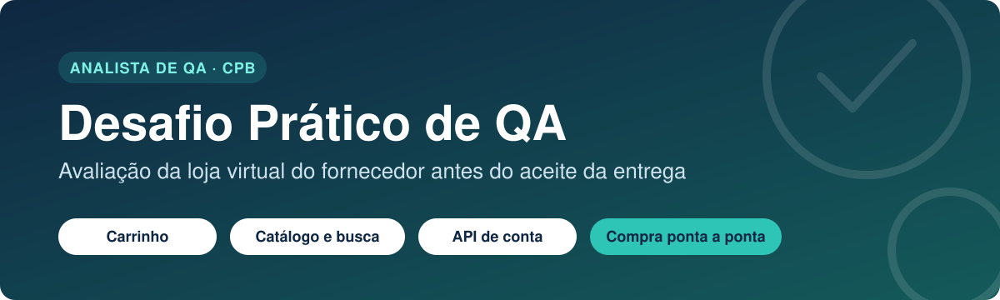

<p align="center">
  
</p>

<h1 align="center">🧪 Desafio Prático de QA – CPB</h1>

<p align="center">
  Avaliação de um módulo de loja virtual antes do aceite da entrega<br>
  <b>Comitê Paralímpico Brasileiro · Vaga de Analista de QA</b>
</p>

<p align="center">
  <a href="https://github.com/galvaomaster/desafio-cpb/actions/workflows/ci.yml"></a>
  
  
  
  <br>
  
  
  
  
  
  <a href="LICENSE"></a>
</p>

---

## 📑 Índice

- [📖 Descrição do Projeto](#-descrição-do-projeto)
- [🚦 Status do Projeto](#-status-do-projeto)
- [✨ Funcionalidades e Demonstração](#-funcionalidades-e-demonstração)
- [🚀 Acesso ao Projeto](#-acesso-ao-projeto)
- [🗺️ Por onde começar](#️-por-onde-começar)
- [🛠️ Tecnologias utilizadas](#️-tecnologias-utilizadas)
- [📂 Estrutura de pastas](#-estrutura-de-pastas)
- [🤝 Pessoas Contribuidoras](#-pessoas-contribuidoras)
- [👨‍💻 Pessoas Desenvolvedoras do Projeto](#-pessoas-desenvolvedoras-do-projeto)
- [📄 Licença](#-licença)

---

## 📖 Descrição do Projeto

> *"Um fornecedor vai nos entregar um módulo de loja virtual. Antes de aceitar a entrega, precisamos saber se o carrinho, o catálogo e a API são confiáveis e o que precisa voltar para o fornecedor corrigir."*
> — demanda da squad dos sistemas esportivos do CPB

Este projeto é a resposta ao **Desafio Prático para a vaga de Analista de QA** do Comitê Paralímpico Brasileiro. Ele avalia o sistema, automatiza o que é mais importante e entrega um **diagnóstico** do que precisa voltar para o fornecedor.

🛒 **Sistema testado:** [automationexercise.com](https://automationexercise.com), uma loja de roupas pública de terceiros, com tela e API, indicada pelo desafio.

> ⚠️ **O site não pertence ao CPB.** Ele faz o papel do módulo do fornecedor e é usado só como sistema sob teste.

**As 4 frentes avaliadas:**

| | Frente | O que precisa ser verdade |
|---|---|---|
| 🛒 | **1. Carrinho de visitante** | quantidade, total e remoção de itens funcionam sem login |
| 🔎 | **2. Catálogo e busca** | a tela e a API contam a mesma história |
| 👤 | **3. API de conta** | o ciclo de vida da conta funciona e o dado pessoal é protegido |
| 💳 | **4. Compra ponta a ponta** | conta criada pela API, login pela tela, compra e resultado conferido |

---

## 🚦 Status do Projeto

<p>
  
</p>

| Indicador | Resultado |
|---|---|
| 🧾 Requisitos definidos | 25: **15 atendem**, **7 não atendem**, 3 aguardam o PO |
| 🥒 Cenários em Gherkin | 31: **22 automatizados**, 9 manuais |
| 🤖 Testes automatizados | **32** (6 no smoke), executando em cerca de 1 minuto |
| 🐞 Observações registradas | **10**, sendo **3 de severidade Alta** |

**Veredito para o aceite:** ❌ **não recomendo aceitar como está.** Antes do aceite, o fornecedor precisa corrigir os itens de severidade Alta:

| | Observação | Severidade |
|---|---|---|
| 💸 | **OBS-011:** pedido confirmado e fatura gerada **sem pagamento** | 🔴 Alta |
| ➖ | **OBS-003:** quantidade negativa gera **total negativo** no carrinho | 🔴 Alta |
| 🔓 | **OBS-009:** a API expõe endereço e nascimento **sem autenticação** | 🔴 Alta |

A lista completa, com passos, evidência e sugestão de correção, está em 👉 [docs/OBSERVACOES.md](docs/OBSERVACOES.md).

---

## ✨ Funcionalidades e Demonstração

### O que a automação faz

- ✅ **Testes de tela e de API** no mesmo projeto, com **Page Object Model**.
- ✅ **Dados dinâmicos:** IDs, nomes e preços vêm sempre da API, sem nada fixo no teste.
- ✅ **Tela × API:** confere que a tela mostra o mesmo que a API devolve.
- ✅ **Data-driven:** o mesmo teste roda com várias quantidades, termos de busca e métodos HTTP.
- ✅ **Status HTTP × corpo:** compara o código HTTP com o `responseCode` e a mensagem da resposta.
- ✅ **Fluxo encadeado da conta:** criar → consultar → entrar → atualizar → apagar.
- ✅ **Limpeza garantida:** toda conta criada é apagada, mesmo quando o teste falha.
- ✅ **Smoke e regressão** separados por tag.
- ✅ **Falhas esperadas:** os testes que provam os bugs ficam marcados e avisam quando o bug for corrigido.
- ✅ **Relatórios** do Playwright e do Allure, e **pipeline** no GitHub Actions.

### 📊 Relatório Allure

<p align="center">
  
</p>

<details>
<summary>🔍 <b>Ver o detalhe de um teste (etapas do fluxo da conta)</b></summary>
<br>
<p align="center">
  
</p>
</details>

### 🐞 Exemplo de bug encontrado: total negativo no carrinho (OBS-003)

<p align="center">
  
</p>

<details>
<summary>💸 <b>Ver outro bug: pedido confirmado sem pagamento (OBS-011)</b></summary>
<br>
<p align="center">
  
</p>
</details>

---

## 🚀 Acesso ao Projeto

### 📋 Pré-requisitos

| Ferramenta | Versão | Como conferir |
|---|---|---|
| [Node.js](https://nodejs.org/) | 20 ou superior | `node -v` |
| [Git](https://git-scm.com/) | qualquer | `git --version` |

Você não precisa de credencial nem de conta no site: os testes criam e apagam as próprias contas.

### ⚙️ Instalação

```bash
# 1. Baixe o projeto
git clone https://github.com/galvaomaster/desafio-cpb.git
cd desafio-cpb

# 2. Instale as dependências
npm ci

# 3. Baixe o navegador usado nos testes (só na primeira vez)
npx playwright install chromium

# 4. (Opcional) Coloque o seu nome nas contas de teste
cp .env.example .env    # depois edite: QA_OWNER=seunome
```

### ▶️ Rodando os testes

| Comando | O que faz | Tempo aproximado |
|---|---|---|
| `npm test` | roda **todos** os testes | 1 min |
| `npm run test:smoke` | roda só os **testes rápidos** (o caminho principal de cada frente) | 20 s |
| `npm run test:api` | roda só os testes de **API** | 10 s |
| `npm run test:ui` | roda só os testes de **tela** | 45 s |
| `npx playwright test --headed` | roda **vendo o navegador** abrir e clicar | — |
| `npx playwright test --ui` | abre o **modo interativo** do Playwright (ótimo para aprender) | — |

### 📊 Vendo os relatórios

| Comando | Relatório |
|---|---|
| `npm run allure` | gera e abre o **Allure** (resumo, etapas e histórico) |
| `npm run report` | abre o relatório do **Playwright** (com vídeo e trace das falhas) |

**Da pipeline:** a cada execução na `main`, os relatórios da última execução são publicados no GitHub Pages, em **https://galvaomaster.github.io/desafio-cpb/**. O link também aparece no resumo da execução, na aba **Actions**.

### 🤔 Entendendo o resultado

```text
  ✓  produto adicionado aparece com nome, preço, quantidade e total   ← passou
  ✘  quantidade negativa não entra no carrinho @known-bug             ← falha esperada (bug conhecido)
  32 passed (53s)
```

> 💡 O **✘ em teste `@known-bug` é esperado**: o teste prova um bug que ainda existe e, por isso, conta como aprovado. Se um dia ele ficar **vermelho** com a mensagem *"expected to fail, but passed"*, o fornecedor corrigiu o bug e a marcação deve ser removida.

---

## 🗺️ Por onde começar

Se você acabou de chegar no projeto, leia nesta ordem. Cada passo usa o anterior.

| Passo | Leia | Para entender |
|---|---|---|
| 1️⃣ | [📘 Guia do QA](docs/GUIA_DO_QA.md) | **comece aqui:** o caminho completo do requisito ao teste, com um exemplo e um glossário |
| 2️⃣ | [🎯 Planejamento](docs/PLANEJAMENTO.md) | os riscos de cada frente, as perguntas ao PO e as premissas |
| 3️⃣ | [🧾 Requisitos](requisitos/requisitos.md) | o que é **correto** em cada frente, e por quê |
| 4️⃣ | [🥒 Cenários](docs/CENARIOS.md) | os cenários em Gherkin (pasta [`features/`](features/)) e o que é automatizado |
| 5️⃣ | [🧪 Testes](tests/) | o código dos testes (cada arquivo começa com "Frente N") |
| 6️⃣ | [🐞 Observações](docs/OBSERVACOES.md) | os bugs encontrados, com evidências |
| 7️⃣ | [🧭 Decisões](DECISOES.md) e [🏗️ Estrutura](docs/ESTRUTURA.md) | por que o projeto é assim e como cada parte funciona |

Também há o [🤖 Uso de IA](docs/USO_DE_IA.md), que conta como a IA ajudou no desafio.

---

## 🛠️ Tecnologias utilizadas

| | Tecnologia | Para quê |
|---|---|---|
| 🎭 | [Playwright](https://playwright.dev/) | automação de testes de tela e de API |
| 🟦 | [TypeScript](https://www.typescriptlang.org/) | linguagem dos testes |
| 🟩 | [Node.js](https://nodejs.org/) | ambiente de execução |
| 📊 | [Allure Report](https://allurereport.org/) | relatório de execução dos testes |
| 🥒 | [Gherkin](https://cucumber.io/docs/gherkin/) | escrita dos cenários (`.feature`) |
| ⚙️ | [GitHub Actions](https://github.com/features/actions) | pipeline de CI (smoke → regressão) |
| 🤖 | [Playwright MCP](https://github.com/microsoft/playwright-mcp) + Claude Code | exploração do site e coleta de evidências |

> ℹ️ O enunciado pede **Cypress**. O projeto usa **Playwright**, que atende aos mesmos requisitos. O motivo está em [DECISOES.md](DECISOES.md#ferramenta-playwright-em-vez-de-cypress).

---

## 📂 Estrutura de pastas

```text
desafio-cpb/
├── requisitos/     🧾 o que é correto em cada frente (comportamento esperado)
├── features/       🥒 cenários em Gherkin, um arquivo por frente
├── tests/          🧪 testes automatizados
│   ├── api/           testes de API
│   └── ui/            testes de tela e o E2E
├── src/            🧰 código de apoio aos testes
│   ├── pages/         Page Objects (um por tela)
│   ├── api/           cliente da API
│   ├── fixtures/      prepara e limpa os dados de cada teste
│   └── data/          dados de teste e geração de usuários fictícios
├── docs/           📚 guia, planejamento, cenários, observações e evidências
├── DECISOES.md     🧭 decisões do projeto
└── .github/        🔁 pipeline de CI
```

Os detalhes de cada parte estão em [docs/ESTRUTURA.md](docs/ESTRUTURA.md).

---

## 🤝 Pessoas Contribuidoras

Contribuições são bem-vindas! Para sugerir uma melhoria:

1. 🍴 Faça um *fork* do projeto.
2. 🌿 Crie uma branch: `git checkout -b minha-melhoria`.
3. ✍️ Se mudar um comportamento esperado, atualize **requisito → cenário → teste**, nessa ordem (veja o [Guia do QA](docs/GUIA_DO_QA.md#-como-adicionar-um-teste-novo)).
4. ✅ Rode `npm run typecheck` e `npm test` antes de enviar.
5. 📬 Abra um *pull request*. O smoke roda automaticamente na pipeline.

📏 **Regras do ambiente:** o site é compartilhado. Use só dados fictícios, contas com o prefixo `QA_` e e-mail `@example.com`, e nunca altere contas de outras pessoas.

---

## 👨‍💻 Pessoas Desenvolvedoras do Projeto

<table>
  <tr>
    <td align="center">
      <a href="https://github.com/galvaomaster">
        <br>
        <sub><b>Anderson Galvão</b></sub>
      </a><br>
      <sub>🧪 QA · planejamento, requisitos, cenários, automação e diagnóstico</sub>
    </td>
  </tr>
</table>

---

## 📄 Licença

Distribuído sob a licença **MIT**. Veja o arquivo [LICENSE](LICENSE) para mais detalhes.

<p align="center">
  Projeto desenvolvido por Anderson Galvão, com o Claudenor fazendo o trabalho pesado de pensar junto. Qualquer bug é culpa dos dois! 
</p>
